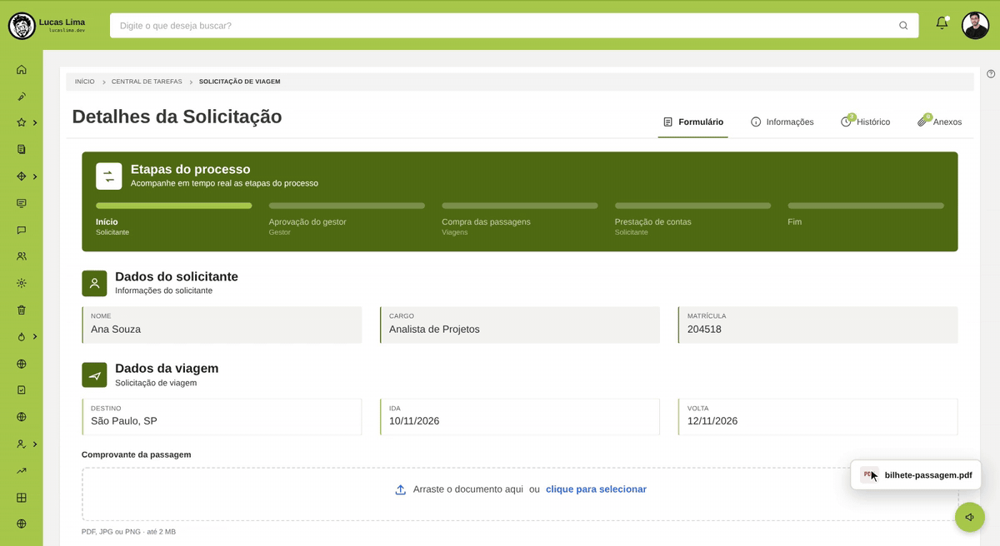

# Fluig-Anexos-FilePond

Card de anexo com **arrastar e soltar** para formulários do Fluig. O documento aparece no próprio card e o arquivo entra na **aba Anexos** da solicitação, pelo upload nativo do Fluig.

O passo a passo completo está no post **[Anexos com arrastar e soltar no formulário do Fluig, com FilePond](https://lucaslima.dev/blog/fluig-anexos-filepond)**, no lucaslima.dev.



## O que este

- Usa o [FilePond](https://pqina.nl/filepond) só como área de arrastar e soltar. Ele não faz upload.
- Valida a extensão (PDF, JPG, PNG) e o tamanho do arquivo antes de anexar.
- Coloca o arquivo no campo de upload da tela da solicitação e dispara o `change`. O Fluig faz o upload e o arquivo aparece na aba Anexos.
- Mostra o documento no card: imagem direto e PDF renderizado pelo [pdf.js](https://mozilla.github.io/pdf.js/), até 2 páginas.
- O botão **Remover** tira o arquivo da aba Anexos e libera o card para outro documento.

Escrito em **jQuery**, que o formulário do Fluig já carrega.

## Arquivos

```
Fluig-Anexos-FilePond/
├── index.html    ← formulário de exemplo com o card de anexo
├── anexos.css    ← estilos do card e do FilePond
├── anexos.js     ← lógica do card
├── preview.gif
├── README.gif
```

## Como usar no seu formulário

1. Copie o bloco `cardAnexo` do `index.html` para o HTML do seu formulário.
2. Adicione as bibliotecas no formulário:
   ```html
   <link
     rel="stylesheet"
     href="https://unpkg.com/filepond@4.30.6/dist/filepond.min.css"
   />
   <script src="https://unpkg.com/filepond@4.30.6/dist/filepond.min.js"></script>
   <script src="https://cdnjs.cloudflare.com/ajax/libs/pdf.js/3.11.174/pdf.min.js"></script>
   ```
   O jQuery não precisa: o Fluig já carrega no formulário.
3. Coloque o `anexos.css` e o `anexos.js` junto com o formulário no Fluig Studio e referencie os dois no HTML.
4. Habilite os anexos no processo.
5. Publique o formulário, abra uma solicitação e arraste um PDF ou uma imagem para o card.

### Ajustes

No começo do `anexos.js`:

| Constante           | Padrão                          | O que faz                               |
| ------------------- | ------------------------------- | --------------------------------------- |
| `EXTENSOES`         | `.pdf`, `.jpg`, `.jpeg`, `.png` | Tipos aceitos                           |
| `MAX_KB`            | `2048`                          | Tamanho máximo, em KB                   |
| `PAGINAS_NA_PREVIA` | `2`                             | Quantas páginas do PDF aparecem no card |

Para ter mais de um card no mesmo formulário, repita o bloco com outros `id` e chame `Anexo.criar` para cada um:

```js
Anexo.criar({
  card: ".cardCertificado",
  input: ".certificado-pond",
  previa: "#previaCertificado",
  nome: "#nomeCertificado",
  remover: "#removerCertificado",
});
```

## Testando fora do Fluig

Abrindo o `index.html` direto no navegador, o card funciona (validação e prévia), mas não há aba Anexos para receber o arquivo. Nesse caso aparece o aviso "Abra o formulário numa solicitação do Fluig para anexar".

## Cuidados

- **Etapas do processo:** o exemplo libera o anexo em qualquer etapa. Num processo real, libere só nas atividades em que a pessoa pode anexar.
- **Remoção pelo nome:** o anexo é encontrado pela descrição, que por padrão é o nome do arquivo. Se alguém renomear na aba Anexos, a remoção não encontra.
- **Seletor do upload:** o script usa o primeiro `input[type="file"]` da tela da solicitação. Se o seu tema adicionar outro, ajuste o seletor em `enviarParaOFluig`.

---

Criado por [Lucas Lima](https://lucaslima.dev) · [@luccsll](https://www.linkedin.com/in/luccsll)
